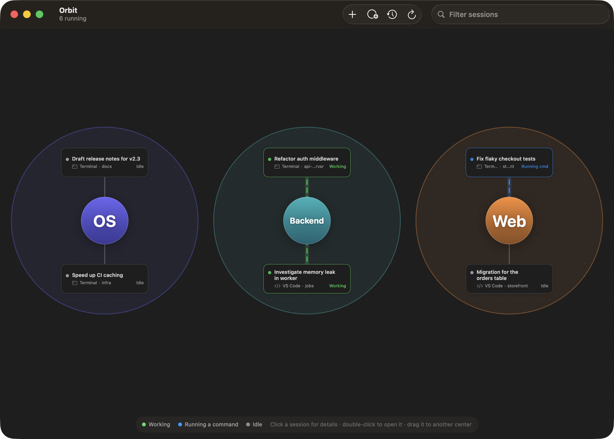
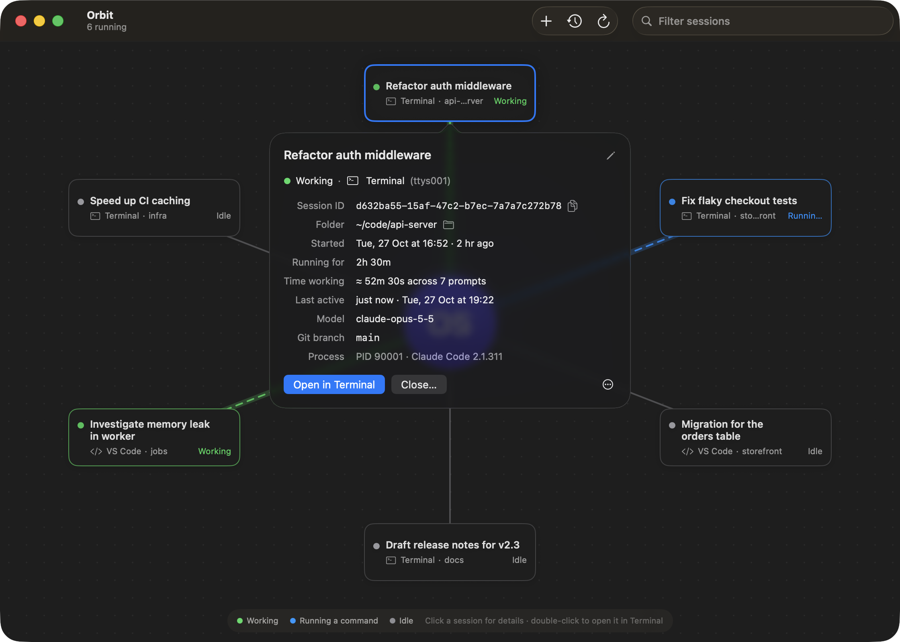
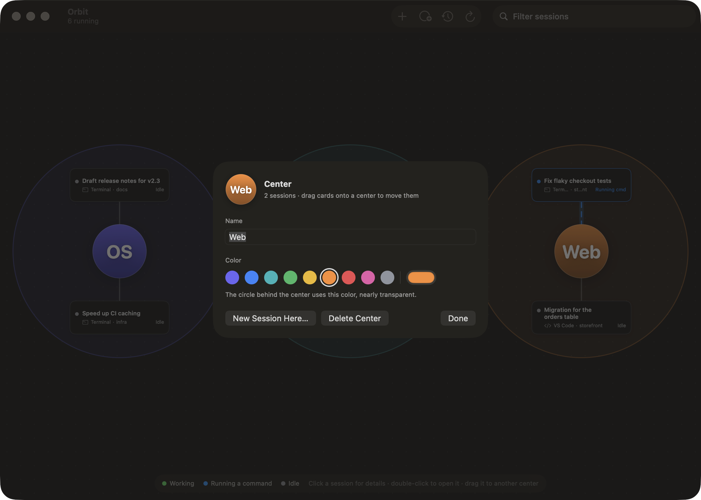

# Orbit

**Your Claude Code sessions, as a map.** Orbit is a small, free macOS app that shows every running [Claude Code](https://docs.anthropic.com/en/docs/claude-code) session orbiting around you, or around centers you create, like "Backend" or "Personal". Jump to any session's Terminal tab, rename it, see how long it's been running, close it, or resume one you closed earlier.



## Features

- **See everything at once.** Every running session (Terminal or VS Code) is a card connected to its center. Animated lines show which ones are working right now.
- **Group sessions around centers.** Add as many centers as you like. Each has its own name and its own colored, nearly transparent circle, with its sessions orbiting inside. Drag a card onto another center to move it there.
- **Open in Terminal.** Double-click a card to bring its Terminal tab to the front. Sessions running in VS Code are moved to Terminal: Orbit stops them there and resumes the same conversation in a new Terminal window.
- **Details and renaming.** Click a card to see the session ID, folder, start time, how long it's been running, an estimate of time spent working, last activity, model and git branch. Rename it with the pencil; the new name also shows up in Claude Code's own `/resume` list.
- **Close and resume.** Close a session from its details or right-click menu. Closed sessions stay in **Recently Closed** (clock button) so you can pick them back up.
- **Start new sessions.** Press ⌘N, or double-click your initials, and choose a folder.
- **Filter.** Type in the search field to highlight matching sessions.
- **Everything stays on your Mac.** Orbit has no network access, accounts or telemetry. It only reads files Claude Code already keeps in `~/.claude`.





## Requirements

- macOS 14 (Sonoma) or later, on Apple Silicon or Intel
- [Claude Code](https://docs.anthropic.com/en/docs/claude-code) installed, with `claude` on your shell's `PATH`
- Apple's Terminal app (Orbit opens and resumes sessions there)

## Install

### Option 1: download

1. Download `Orbit.zip` from the [latest release](../../releases/latest) and unzip it.
2. Move `Orbit.app` to your Applications folder.
3. Orbit isn't signed with a paid Apple Developer certificate, so macOS blocks it the first time. Either run:
   ```sh
   xattr -dr com.apple.quarantine /Applications/Orbit.app
   ```
   or try to open it once, then go to **System Settings → Privacy & Security** and click **Open Anyway**.

### Option 2: build from source

You need Apple's command-line developer tools (`xcode-select --install`).

```sh
git clone https://github.com/omarsinno54/orbit-sessions.git
cd orbit-sessions
./build.sh            # builds and installs to ~/Applications/Orbit.app
```

Use `./build.sh --no-install` to build into `build/Orbit.app` without installing.

## Using Orbit

| Action | How |
| --- | --- |
| See a session's details | Click its card |
| Open it in Terminal | Double-click its card, or **Open in Terminal** in the details |
| Rename it | Click the pencil in the details (leave it empty to go back to the automatic title) |
| Close it | **Close…** in the details, or right-click the card |
| Resume a closed session | Clock button in the toolbar → **Resume** |
| Start a new session | ⌘N or the **+** button (goes to your main center) |
| Add a center | The **New Center** button in the toolbar |
| Rename or recolor a center | Click the center |
| Start a session in a center | Double-click the center, or **New Session Here…** in its editor |
| Move a session to another center | Drag its card onto that center's circle, right-click → **Move to Center**, or use the **Center** menu in its details |
| Delete a center | Its editor, or right-click it (its sessions go back to the main center) |
| Refresh now | ⌘R (Orbit also refreshes every 2 seconds) |

The first time Orbit opens something in Terminal, macOS asks whether Orbit may control Terminal. Click **Allow**. If you said no by accident, turn it back on in **System Settings → Privacy & Security → Automation**.

**Your main center** shows your initials, taken from your Mac account name. Click it to give it a name and color of your own, or change the initials with:

```sh
defaults write io.github.omarsinno54.orbit initials XY
```

### Command line

The app binary also works from the terminal:

```sh
ORBIT=~/Applications/Orbit.app/Contents/MacOS/Orbit
$ORBIT --list                       # running and recently closed sessions
$ORBIT --details <session-id>       # details for one session
$ORBIT --rename <session-id> "Title"
$ORBIT --help
```

## How it works

- **Running sessions** come from `~/.claude/sessions/<pid>.json`, which Claude Code writes for each live session. Orbit checks that each process is still a running Claude process, then works out which app it lives in (Terminal, VS Code, …) and its Terminal tab.
- **Titles, folders and stats** come from the session transcripts in `~/.claude/projects/`.
- **Open** finds the Terminal tab by its terminal device (tty) using AppleScript.
- **Close** sends the session a normal quit signal (SIGTERM), and force-quits it only if it hasn't stopped after 8 seconds. Claude Code saves conversations as it goes, so closed sessions can be resumed.
- **Move to Terminal** (for VS Code sessions) closes the session the same way, then runs `claude --resume <session-id>` in a new Terminal window, in the session's folder.
- **Centers** and which session belongs to which are saved in Orbit's own preferences (`io.github.omarsinno54.orbit`), keyed by session ID, so a session returns to its center when you resume it.
- **Rename** appends a `custom-title` record to the transcript and writes `custom-title.json` beside it. This is the same format Claude Code's `/rename` uses.

## Caveats

- Orbit depends on Claude Code's **internal, undocumented files**, which can change in any Claude Code update. It was built and tested with Claude Code 2.1.311 on macOS 26. If something breaks after an update, please open an issue.
- Opening and resuming only work with **Apple's Terminal**. iTerm2, Ghostty and Warp aren't supported yet (contributions welcome).
- After moving a session out of VS Code, don't type into the old VS Code panel, or VS Code will start a second copy of the same conversation.
- "Time working" is an estimate: it adds up the time from each prompt to Claude's last reply before the next prompt.

## Contributing

Issues and pull requests are welcome. The whole app is one Swift file (`Sources/Orbit.swift`) with no dependencies. `./build.sh` builds it, and launching with `-demo YES` shows sample sessions, which is handy for screenshots and UI work:

```sh
open ~/Applications/Orbit.app --args -demo YES
```

## License

[MIT](LICENSE)

---

Orbit is an independent open-source project. It is not affiliated with, endorsed by or sponsored by Anthropic. Claude and Claude Code are trademarks of Anthropic, PBC.
